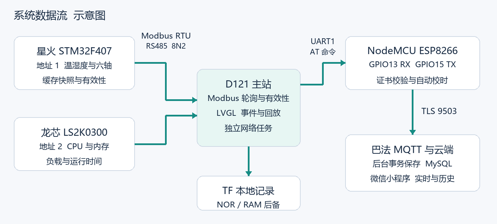

# D121 双节点设备监控终端

基于玄铁 D121、星火 STM32F407 与龙芯 LS2K0300 的设备监控项目：主站通过 Modbus RTU 汇聚两个从站，在触摸屏显示和回放历史，并通过 ESP8266 将摘要和关键事件上传至云后台，供微信小程序查看。



本仓库包含项目主站、两个从站、网络模块定制代码、云后台、小程序与交付资料。星火从站包含其所需的 RT-Thread / STM32 BSP；D121 和 ESP8266 的厂商 SDK 通过固定的上游提交与仓库内覆盖源码重建。云后台与小程序原有目录保持不变，云容器仍从根目录 Dockerfile 构建。

## 系统功能

- **本地采集与回放**：D121 轮询星火的温湿度和六轴数据，以及龙芯的 CPU、内存、负载和运行时间；本地界面展示趋势和事件，TF 卡保存记录并支持回放。
- **故障追溯**：关键事件和事前有效摘要进入 NOR 队列，云后台完成数据库提交后返回应用确认；设备接收确认后移出，重发事件按身份去重。
- **远程查看**：ESP8266 使用 TLS 校验 CA、服务器域名和证书有效期；云后台归档摘要与事件，小程序提供登录、双站状态、趋势和事件详情。

星火记录目标约 10 Hz，龙芯目标约 1 Hz；云端约每秒保存摘要。振动值是现有采样的每秒峰值，并非 RMS、频谱或动作分类。MQTT 使用 QoS0，可靠补传来自应用层队列、确认和数据库去重。

## 仓库结构

| 路径 | 内容 |
|---|---|
| [`firmware/d121/`](firmware/d121/) | 主站项目源码、SDK 差异、板级配置和固定上游版本 |
| [`firmware/star-stm32f407/`](firmware/star-stm32f407/) | 星火地址 1 源码、驱动、RT-Thread / STM32 BSP 与构建清单 |
| [`firmware/loongson-slave2/`](firmware/loongson-slave2/) | 龙芯地址 2 程序、服务、安装脚本与测试 |
| [`firmware/esp8266-at/`](firmware/esp8266-at/) | ESP-AT TLS、自动校时和专用引脚定制源码 |
| [`firmware/common/`](firmware/common/) | 三端使用的公共 Modbus RTU 协议头 |
| [`backend/`](backend/) / [`miniprogram/`](miniprogram/) | 云端归档服务、数据库、接口和微信原生小程序 |
| [`docs/`](docs/) | 寄存器表、接线示意、交付与拍摄资料、验收记录 |

## 接线与协议

星火为 Modbus 从站地址 1，龙芯为地址 2；RS485 为 115200 / 8N2。详细地址、单位和有效性见[寄存器表](docs/Modbus寄存器表V1.md)。

NodeMCU 使用独立 USB 供电：D121 PA2/TX → NodeMCU D7/GPIO13/RX，D121 PA3/RX ← D8/GPIO15/TX，GND 共地；两板 3.3V 不连接。原 RX/TX 保留 USB 烧录用途。见[引脚位置图](docs/delivery/assets/wiring.png)。

## 构建与测试

### 云后台和小程序

```powershell
python -m venv .venv
& .\.venv\Scripts\python.exe -m pip install -r requirements.lock.txt
if (!(Test-Path config.private.json)) { Copy-Item config.example.json config.private.json }
& .\.venv\Scripts\python.exe -m pytest -q
node tests/client.test.cjs
```

已有私有配置时不要覆盖。开发者工具导入 `miniprogram/`；实际账号、数据库和配对信息使用本机私有配置或部署环境变量，不能提交仓库。后端本地启动、云托管与备份恢复见[云端说明](docs/云端使用说明.md)。

### 星火 STM32F407

提供相对路径构建脚本，使用已验证的 RT-Thread Studio ARM GCC 5.4.1 工具链：

```powershell
python tools/build_star.py --toolchain '工具链的bin目录'
```

脚本编译 `build-manifest.json` 中的 166 个源文件，输出 `firmware/star-stm32f407/build/rtthread.bin`；只编译，不烧录。历史 Studio 工程也保留，但迁移目录后应在 Studio 中重新配置工具链与路径。见[星火说明](firmware/star-stm32f407/README.md)。

### 龙芯从站

```sh
cd firmware/loongson-slave2
make test
make package  # 需要 LoongArch64 交叉工具链；可用 TOOLCHAIN=... 指定前缀
```

`make test` 在 Linux 主机运行单元、模拟 GPIO 运行路径和 PTY 集成测试；它不替代真实 RS485 电气验证。部署与现有系统重启限制见[龙芯说明](firmware/loongson-slave2/README.md)。

### D121 与 ESP8266 源码准备

需要 Git 和 Python 3.9+。以下命令在新的目标目录检出固定上游提交，校验并应用仓库内项目覆盖文件；非干净的已有目录会被拒绝。

```powershell
python tools/prepare_vendor.py d121 --destination ../d121-sdk
python tools/prepare_vendor.py esp8266-at --destination ../esp-at
```

D121 使用 ArtInChip SDK 的交叉工具链和 SCons 构建，存储配置以板级 defconfig 与实际硬件为准。ESP8266 还需固定版本的 ESP8266 RTOS SDK、子模块与 LX106 工具链。具体步骤见[D121 说明](firmware/d121/README.md)和[ESP8266 说明](firmware/esp8266-at/README.md)。这些是厂商 SDK 的外部构建依赖，不包含用户私有配置。

## 验收与边界

截至 2026-10-25 的记录：独立 Modbus 工具在真实 RS485 总线上每站交替读取 20 次；设备 TLS 的错误 CA、错误域名及过期证书拒绝对照通过；短时停传和单站恢复后关键事件补传成功；真实微信云端 15 项通过，用户确认手机移动网络下登录、双站实时数据、历史列表和事件详情均正常。[验收摘要](docs/evidence/acceptance-summary.json)与[交付说明书](docs/delivery/D121_交付说明书.pdf)包含证据和适用范围。

长期观测按用户要求暂停。完整离线原始波形上云、精细动作分类、微信主动通知和远程控制尚未实现；龙芯普通系统软件重启仍有驱动崩溃问题，冷启动与从站服务恢复已有记录。手机实测不等于小程序公众版审核通过。

[拍摄与发言指南](docs/delivery/D121_拍摄与发言指南.pdf)包含分镜和口播；[离线提词器](docs/delivery/演示提词器.html)和[讲解页](docs/delivery/演示讲解页.html)可下载后在浏览器打开。实机视频由使用者按指南拍摄。

## 第三方源码

星火目录包含 RT-Thread 与 STM32 厂商组件，保留其原有许可证与版权说明。D121 SDK、ESP-AT、ESP8266 RTOS SDK 及所用工具链分别由各上游提供，使用时请查看各上游随附的授权文件；本仓库没有将第三方源码统一改成新的许可证。
