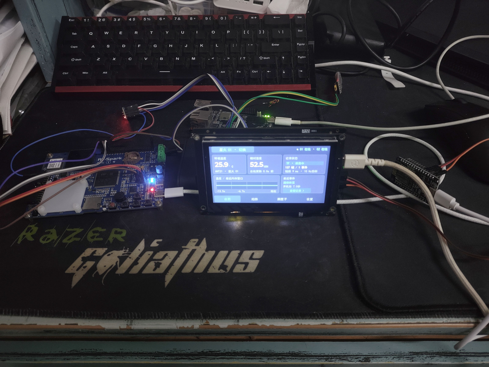
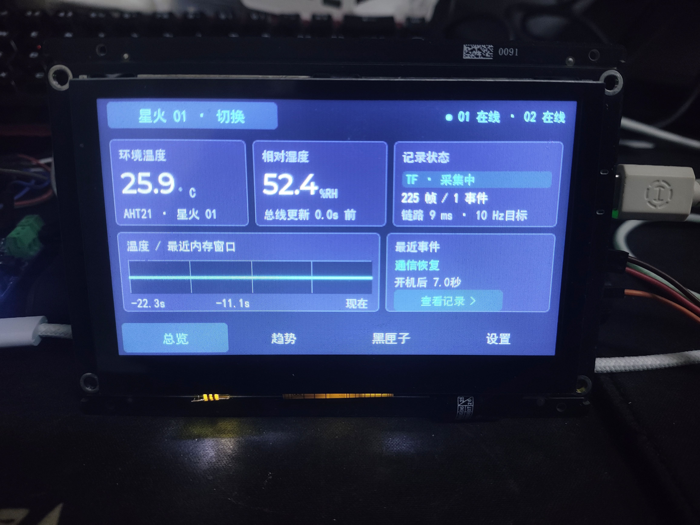
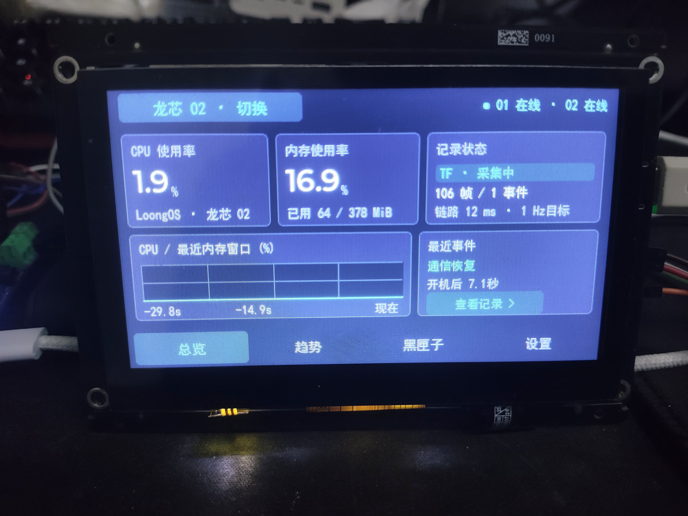
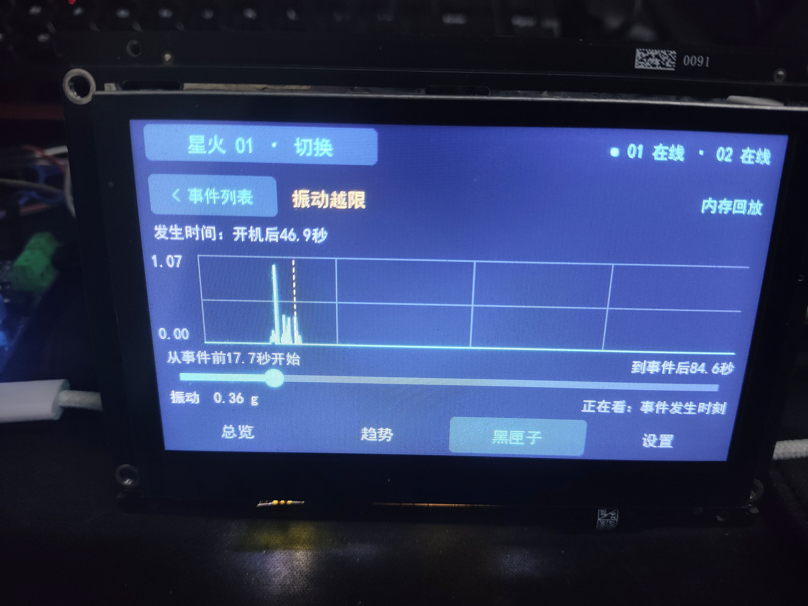
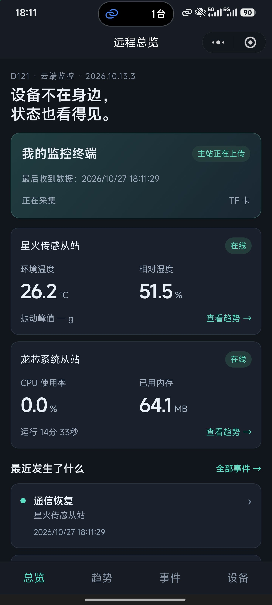
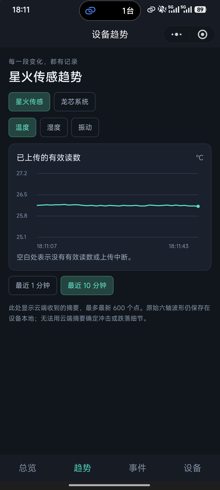
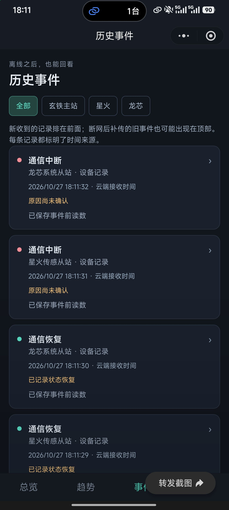
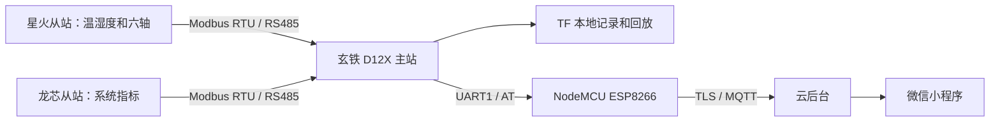

# 玄铁 D12X 多从机设备监控与异常追溯系统

> 2026 RT-Thread 嵌入式电子设计大赛参赛作品 · 玄铁 D12X + RT-Thread + LVGL

设备运行过程中，除了知道当前状态，还需要在出现异常时找到当时发生了什么。本项目面向多从机工业场景，以玄铁 D12X 开发板为主站，通过 RS485 总线集中采集设备数据，在本地记录和回放，并把摘要与关键事件上传云端，供微信小程序查看。

本次实物演示使用手边的两台设备作为从站：星火 STM32F407 采集温湿度和六轴数据，龙芯 LS2K0300 提供系统运行指标。当前代码和界面针对这两个从站实现和验证；接入更多设备需要相应扩展采集、数据模型及界面，不能直接视为已经验证。



*系统实物：玄铁 D12X 主站、星火与龙芯从站及 NodeMCU 网络模块。照片和下方截图展示拍摄时的状态，不代表设备当前在线。*

## 一眼了解作品

| 功能 | 当前实现 |
|---|---|
| 双站采集 | 主站使用 RS485 / Modbus RTU 轮询两台不同类型的从站，分别维护在线与数据状态 |
| 本地记录与回看 | 触摸屏查看实时数据、趋势和事件；采集数据与事件可记录到 TF 卡并回放 |
| 异常追溯 | 记录通信中断、恢复及振动越限等事件，支持查看事件附近的数据 |
| 关键事件补传 | 网络中断时将关键事件及可用事前摘要保存到 NOR 队列，恢复后等待云端保存确认再移除 |
| 远程查看 | 微信小程序查看两站状态、趋势、历史事件和详情 |

## 实机与界面

<table>
  <tr><td align="center"><br>星火从站：温湿度及本地记录状态</td><td align="center"><br>龙芯从站：CPU、内存及本地记录状态</td></tr>
</table>



*上图为本地振动越限事件的内存回放画面；TF 历史回放是另一个记录与读取路径。*

<table>
  <tr><td align="center"><br>远程总览</td><td align="center"><br>云端摘要趋势</td><td align="center"><br>历史事件</td></tr>
</table>

*小程序截图来自手机拍摄时的实际界面；事件的时间来源以页面标注为准。趋势显示已上传摘要，并非完整离线原始波形。*

## 系统架构



本仓库包含主站、两个从站、网络模块定制代码、云后台、小程序和技术文档。星火从站包含其所需的 RT-Thread / STM32 BSP；主站和 ESP8266 的厂商 SDK 通过固定的上游提交与仓库内覆盖源码重建。云后台与小程序原有目录保持不变，云容器从根目录 Dockerfile 构建。

[查看发布版本](https://github.com/remukisama/d121-remote-monitor/releases/latest)

项目的 RT-Thread 线程、同步、存储设计与验收范围见[软件设计与验证说明](docs/软件设计与验证.md)。

## 系统功能

- **本地采集与回放**：主站轮询星火的温湿度和六轴数据，以及龙芯的 CPU、内存、负载和运行时间；本地界面展示趋势和事件，TF 卡保存记录并支持回放。
- **故障追溯**：关键事件和事前有效摘要进入 NOR 队列，云后台完成数据库提交后返回应用确认；设备接收确认后移出，重发事件按身份去重。
- **远程查看**：ESP8266 使用 TLS 校验 CA、服务器域名和证书有效期；云后台归档摘要与事件，小程序提供登录、双站状态、趋势和事件详情。

星火记录目标约 10 Hz，龙芯目标约 1 Hz；云端约每秒保存摘要。振动值是现有采样的每秒峰值，并非 RMS、频谱或动作分类。MQTT 使用 QoS0，可靠补传来自应用层队列、确认和数据库去重。

## 仓库结构

| 路径 | 内容 |
|---|---|
| [`firmware/d121/`](firmware/d121/) | 主站项目源码、SDK 差异、板级配置和固定上游版本 |
| [`firmware/star-stm32f407/`](firmware/star-stm32f407/) | 星火地址 1 源码、驱动、RT-Thread / STM32 BSP 与构建清单 |
| [`firmware/loongson-slave2/`](firmware/loongson-slave2/) | 龙芯地址 2 程序、服务、安装脚本与测试 |
| [`firmware/esp8266-at/`](firmware/esp8266-at/) | ESP-AT TLS、自动校时和专用引脚定制源码 |
| [`firmware/common/`](firmware/common/) | 三端使用的公共 Modbus RTU 协议头 |
| [`backend/`](backend/) / [`miniprogram/`](miniprogram/) | 云端归档服务、数据库、接口和微信原生小程序 |
| [`docs/`](docs/) | 寄存器表、接线示意和验证记录 |

## 接线与协议

星火为 Modbus 从站地址 1，龙芯为地址 2；RS485 为 115200 / 8N2。详细地址、单位和有效性见[寄存器表](docs/Modbus寄存器表V1.md)。

NodeMCU 使用独立 USB 供电，按模块板上的引脚丝印连接：

| 玄铁 D12X 主站 | NodeMCU | 作用 |
|---|---|---|
| PA2 / TX | D7 / GPIO13 / RX | 主站发送 → 模块接收 |
| PA3 / RX | D8 / GPIO15 / TX | 模块发送 → 主站接收 |
| GND | GND | 信号共地 |

两板 3.3V 不连接。NodeMCU 原 RX/TX 保留 USB 烧录用途。

## 构建与测试

### 云后台和小程序

```powershell
python -m venv .venv
& .\.venv\Scripts\python.exe -m pip install -r requirements.lock.txt
if (!(Test-Path config.private.json)) { Copy-Item config.example.json config.private.json }
& .\.venv\Scripts\python.exe -m pytest -q
node tests/client.test.cjs
```

已有私有配置时不要覆盖。开发者工具导入 `miniprogram/`；实际账号、数据库和配对信息使用本机私有配置或部署环境变量，不能提交仓库。后端本地启动、云托管与备份恢复见[云端说明](docs/云端使用说明.md)。

### 星火 STM32F407

提供相对路径构建脚本，使用已验证的 RT-Thread Studio ARM GCC 5.4.1 工具链：

```powershell
python tools/build_star.py --toolchain '工具链的bin目录'
```

脚本编译 `build-manifest.json` 中的 166 个源文件，输出 `firmware/star-stm32f407/build/rtthread.bin`；只编译，不烧录。历史 Studio 工程也保留，但迁移目录后应在 Studio 中重新配置工具链与路径。见[星火说明](firmware/star-stm32f407/README.md)。

### 龙芯从站

```sh
cd firmware/loongson-slave2
make test
make package  # 需要 LoongArch64 交叉工具链；可用 TOOLCHAIN=... 指定前缀
```

`make test` 在 Linux 主机运行单元、模拟 GPIO 运行路径和 PTY 集成测试；它不替代真实 RS485 电气验证。部署与现有系统重启限制见[龙芯说明](firmware/loongson-slave2/README.md)。

### 主站与 ESP8266 源码准备

需要 Git 和 Python 3.9+。以下命令在新的目标目录检出固定上游提交，校验并应用仓库内项目覆盖文件；非干净的已有目录会被拒绝。

```powershell
python tools/prepare_vendor.py d121 --destination ../d121-sdk
python tools/prepare_vendor.py esp8266-at --destination ../esp-at
```

主站使用 ArtInChip SDK 的交叉工具链和 SCons 构建，存储配置以板级 defconfig 与实际硬件为准。ESP8266 还需固定版本的 ESP8266 RTOS SDK、子模块与 LX106 工具链。具体步骤见[主站说明](firmware/d121/README.md)和[ESP8266 说明](firmware/esp8266-at/README.md)。这些是厂商 SDK 的外部构建依赖，不包含用户私有配置。

## 验收结果与范围

以下是已有的历史验收记录，不代表本次查看时设备或云服务的实时状态。

| 验收项目 | 记录结果 | 证据与边界 |
|---|---|---|
| Modbus RTU | 独立 MinimalModbus 工具经真实 RS485 总线交替读取两站，各 20 次 | 经主站串口桥转发，非独立 USB-RS485 适配器；见[迁移与实机记录](docs/evidence/modbus-acceptance.md) |
| 受控短时故障 | 暂停网络 20 秒并停止/恢复星火应答；龙芯继续采集，2 条事件排队后清空 | 见[短时故障记录](docs/evidence/short-fault-result.json)和[网络验收说明](docs/evidence/network-acceptance.md)；不代表长期稳定性 |
| 设备 TLS | 正确连接及错误 CA、错误域名、过期证书拒绝对照通过 | 对应设备到 MQTT 服务的链路；见[网络验收说明](docs/evidence/network-acceptance.md) |
| 云端与手机 | 真实微信云端 15 项复验通过；手机移动网络的登录、双站实时数据、历史列表和事件详情经用户确认正常 | 手机结果为用户反馈，没有独立抓包；见[验收摘要](docs/evidence/acceptance-summary.json) |
| 主机自动化 | 后端、客户端和部分固件主机测试通过 | [GitHub Actions](https://github.com/remukisama/d121-remote-monitor/actions)；不替代完整固件构建或硬件验收 |

以上结果对应当前两台从站与记录中的受控场景。长期运行、更多从站、任意时刻断电零损失尚未验收；完整离线原始波形上云、动作分类、微信主动通知及远程控制未实现。龙芯普通系统软件重启的已知问题见[龙芯说明](firmware/loongson-slave2/README.md)。

## 第三方源码

星火目录包含 RT-Thread 与 STM32 厂商组件，保留其原有许可证与版权说明。主站 SDK、ESP-AT、ESP8266 RTOS SDK 及所用工具链分别由各上游提供，使用时请查看各上游随附的授权文件；本仓库没有将第三方源码统一改成新的许可证。
