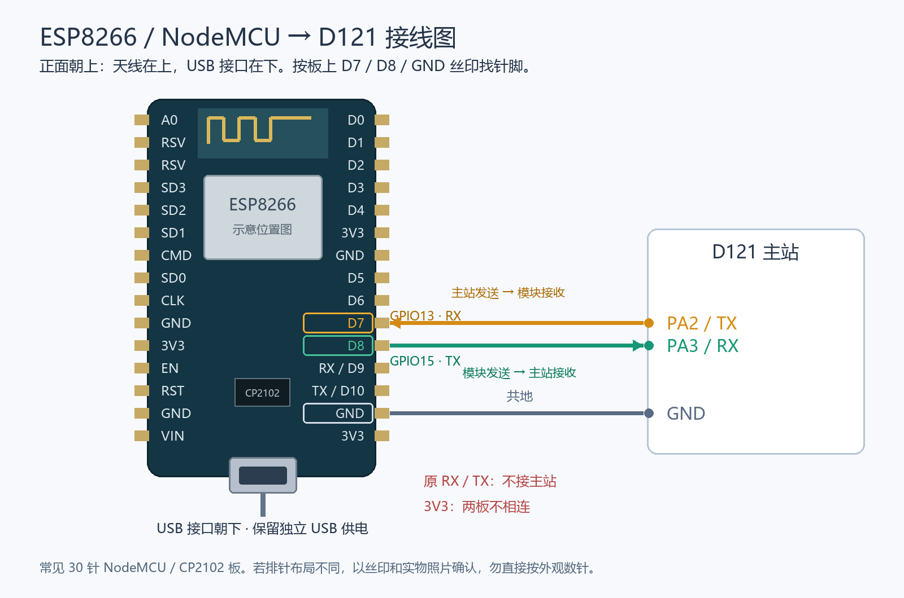

# 设备 TLS 与网络恢复验收（2026-10-25）

D121 与 NodeMCU 已通过新引脚连接并实际完成加密 MQTT 上传、云端保存确认和短时故障恢复。设备 TLS 同时检查 CA、域名和证书有效期。16:24 的短时验收通过；随后热点不可用导致重连失败，用户确认曾关闭热点或手机离开过，恢复后主站自动重连，真实微信云端 15 项复验通过。用户随后确认手机移动网络下登录、两站实时数据、历史列表和事件详情四项均正常。当前约定范围的开发与短时验收已收口，长期观测按用户要求保持暂停。

## 最终接线与版本

| D121 | NodeMCU | 用途 |
|---|---|---|
| PA2 / TX | D7 / GPIO13 / RX | 主站发送 AT 命令 |
| PA3 / RX | D8 / GPIO15 / TX | 主站接收 AT 应答 |
| GND | GND | 共地 |

NodeMCU 保留独立 USB 供电，两板 3.3V 不相连。原 RX/TX 不再接 D121；COM10 对应 USB 桥和 ROM 烧录入口，最终固件的日常 AT 口在 D7/D8。短时测试只打开 USB 串口并保持 DTR/RTS 关闭，没有从电脑发送数据，也没有触发 ROM 复位。

| 部件 | 当前检查点 |
|---|---|
| D121 SDK | `D:\xuantie\luban-lite`，提交 `b5edcf8ad`，前一网络修复 `1cf5b8426` |
| D121 更新包 | `master-tls.img`；SHA256 `7761ee85bef2dc34377b6c57a229e206a268dd061c817845495d66094af15a41` |
| ESP-AT 源码 | `D:\codex相关项目\ESP8266-AT-TLS`，提交 `496728b`，上游 `5249c31d1df78c68622b33ffa9fd82b9991c28be` |
| ESP8266 SDK | `ff16a35c362047b47c0b3d29c02ef9755b623447`，启用日期验证和自动 SNTP；26 MHz 晶振、40 MHz Flash |
| NodeMCU 工厂参数 | 仅 `0xf1000` 分区从台架 GPIO1/3 改为 GPIO15/13；SHA256 `4f37fd5a425eba5dd64c586a6b9fe1d956dc33f8be9547e1ed81a8065406fb7b` |
| 云端 | 已有 `d121-monitor-015`，本轮没有重新发布；后台接收侧 MQTT 配置未改为 TLS |

运行中主站配置已备份并仅修改为 `tls=1`、端口 `9503`，完整字段回读一致；本机私有配置同步这两项。实际密码、账号、原始配置和串口私密记录均不放入公开证据或交付包。

## 已通过的验证

- 生产 C 网络任务通过 ASan/UBSan：正确 AP/IP 复用，错误 AP/无 IP 时重新加入、旧 AT 易失配置、发送提示与 SEND OK 分别超时、清理过程保留原始错误、断开及复位诊断；MQTT/分片报文及 200,000 字节 fuzz 通过。见 `tls-worker-tests-20261025.txt`。
- NodeMCU 实测正确 CA/域名连接、错误 CA 拒绝、错误域名拒绝、恢复正确设置成功。标准固件在同一 CA/目标下接受的过期证书，新固件在取得 2026 年时间后拒绝。见 `esp-date-tls-result.json` 与 `esp-standard-expiry-control.json`。测试索引 1/2 不供正常主站连接使用，正常连接固定 CA 索引 0。
- 接回 D7/D8 后主站实际显示 `tls=1 auth_verified=1 online=1`，原有 10 条积压事件清空，应用确认累计 16。见 `after-dedicated-uart-wiring.txt`、`tls-queue-progress.txt`。
- 第一轮真实微信开发者工具经云托管完成 15 项：真实登录/配对、双站新数据、振动与 MySQL 历史、旧事件保留、持续接收、注销撤销及重新登录。见 `wechat-tls-before-fault.json`，不是手机移动网络验收。
- 16:23:45–16:24:29 受控回归通过，见 `short-fault-result.json` 与 `short-fault-board.txt`：打开 COM10 不影响上传；在 USB 串口保持打开时重连成功；两次重连复用现有 Wi-Fi，`wifi_joins` 仍为 0、`wifi_reused` 从 1 到 3。暂停网络 20 秒并停止/恢复星火接收程序，龙芯继续正常采集；2 条新事件排队后全部清空，应用确认从 16 到 24，事件发送从 10 到 12。
- 同一回归结束：两站在线且有效，TF 星火写入 28,658、龙芯 3,209，漏写/写入错误为 0，看门狗未触发。网络 errors、timeouts、解析错误、持久化错误均未增加；启动时未接线产生的旧 timeouts=10 保留，不将累计值描述为零。

## 后续发现与剩余工作

第二次云端复核时设备已经离线，主站显示 `WIFI DISCONNECT` 后重新加入热点失败（`wifi_error=3`）；当时 TLS 尚未重新进入认证阶段。双站和 TF 继续正常。用户随后确认热点曾关闭或手机离开过、现已恢复，主站无需重刷或人工重启即重新进入 `online=1 tls=1 auth_verified=1`。失败记录单独保留在 `after-cloud-readback-failure.txt`，不覆盖历史证据。

恢复后的两个主站检查点间，`submitted` 从 782 增至 936，attempts=38、errors=29、timeouts=10 均未增加，队列始终为 0；这些错误累计值包含热点关闭期间的加入失败。TF 星火写入 42,811→43,517，龙芯 4,581→4,649，均无漏写/写入错误，看门狗未触发。见 `hotspot-restored-board.txt`、`hotspot-restored-board-final.txt` 与 `hotspot-recovery.json`。

恢复后真实微信云托管 15 项再次全部通过：设备在线且双站新数据有效，振动历史 36 点、事件 20 条、旧事件 42 保留、最新事件详情 436 可读，持续接收计数 6,631→6,649，注销及再次登录正常。见 `wechat-hotspot-restored.json`。本次不再将热点不可用列为未解决代码缺陷；未经长时间观测，不宣称全部间歇问题永久消失。

| 工作 | 状态 |
|---|---|
| 热点关闭/离开后的掉线恢复 | 用户确认原因，热点恢复后自动重连及云端复验通过；当前无此阻塞 |
| 手机移动网络真实访问 | 用户真机确认登录、两站实时数据、历史列表和事件详情四项均正常；见 `mobile-network-acceptance.json` |
| 8 小时观测 | 按用户要求暂停，不自动重启 |
| 完整离线原始波形上云、精细动作分类、主动通知/远控 | 当前版本范围外，不能列为已实现 |

手机验收依据为本会话用户反馈，没有另行采集手机抓包、截图或网络制式信息；不能将其描述为自动化真机测试或微信正式发布审核通过。长期稳定性与任意时刻突然断电零损失仍未验收。

## 备份、交付与恢复

原模块 AT 1.7.4 全部 4,194,304 字节已经按 64 KiB 分段独立读取两遍比较，并匹配设备整片 MD5；SHA256 `5f139363d02183623a1488755c546d285bf59a683469269a78ed13b515cfb7f8`。文件位于 `D:\xuantie\work\backups\network-hardening-20261022\nodemcu-at174-verified.bin`，包含原有配置，禁止公开。完整回刷旧备份尚未实操，不能称恢复演练通过。旧固件恢复后需同步恢复原 GPIO1/3 接线与主站配置。

`package_delivery.py` 只校验并打包已经使用的镜像，不操作设备。`D121-ESP8266-TLS-20261025.zip` 包含主站更新镜像、ESP 分段镜像、最终 D7/D8 参数、空 NVS、接线图和 manifest，不含设备账号或原始 Flash 备份。ESP 使用物理 4 MiB 芯片中的官方 2 MiB 分区布局；首次完整部署会初始化 NVS，需重新配置。上游附带的示例客户端密钥不用于本项目的单向服务器认证。

ESP 烧录应按 manifest 的 offset 使用 esptool，DIO/40 MHz/2MB、115200；不得把台架 GPIO1/3 参数当作最终参数。D121 日常更新仅写 OS/rodata，沿用 `work/scripts/flash/d12x_flash.ps1`，不覆盖 SPL、NOR 队列和 TF。操作前保留私有配置、原镜像和现有历史；实际烧录工具已做分段哈希校验。包内固件不携带用户配置，不能靠重新烧录排除热点不可见问题。

ESP 的 WSL 构建依赖与中文路径兼容补丁见其源码工程 `D121_TLS_BUILD.md`；镜像构建时的嵌入版本字符串仍对应构建当时上游提交，后续保存源码检查点不代表跨时间重建字节完全一致。最终部署分段及压缩包哈希见 `delivery-manifest.json`、`delivery-package.json`。
